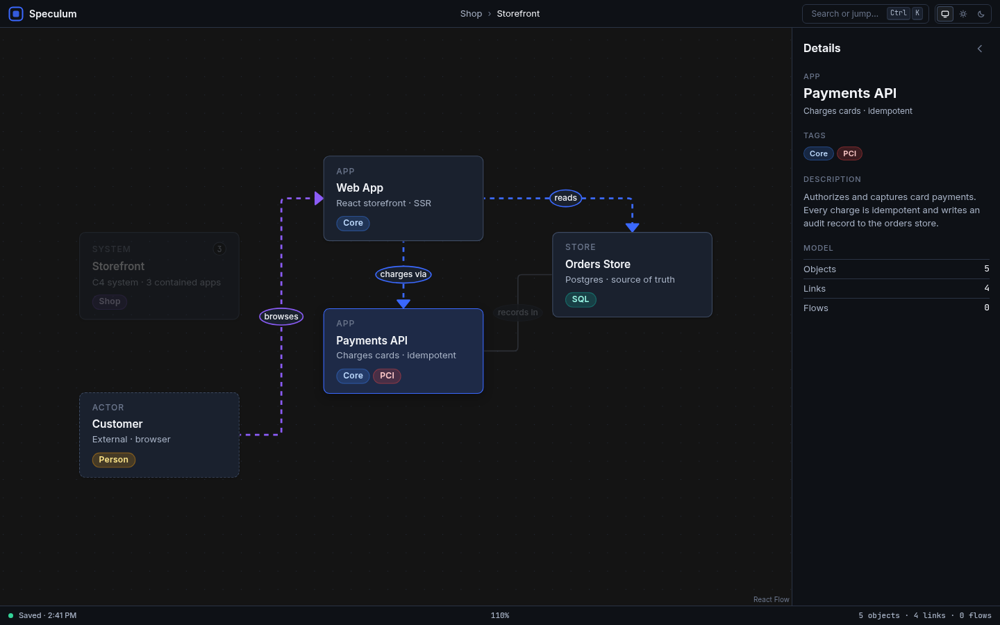

# Speculum

**Speculum** (Latin: *mirror*) is a local-first desktop app for mapping how things fit together:
boxes inside boxes, links between them, and flows you can play step by step. Use it for
software architecture (C4-style system / app / component diagrams) or as a visual filing
system for anything with parts and connections.

Built with a Rust core and a [Tauri v2](https://tauri.app) desktop shell with a React UI.
Your files stay on your computer: no account, no cloud, no telemetry.

> Status: early development (`v0.0.x-dev`). File formats and features will change.



## Features

Working today:

- Nested model: actors, systems, groups, apps, stores and components, each with tags, status and a description
- Links between boxes with labels and direction; hover a box to highlight everything it connects to
- Flows (step-by-step paths over links) in the data model
- Undo / redo with command history
- Safe saving: atomic writes, an append-only journal, autosave, snapshots and crash recovery
- Dark, light and system themes from a single design-token file

Planned:

- Drag-and-drop canvas with click-to-zoom into child diagrams, minimap and snap guides
- Flow playback with animated paths
- Custom box types, list view, notes, checklists and attachments
- Import / export (JSON, YAML), search and command palette

## Download

Test builds for Windows, macOS and Linux are attached to
[Releases](../../releases) and to each [CI run](../../actions).

| OS | File |
|---|---|
| Windows 10/11 | `Speculum_x.y.z_x64-setup.exe` (or `.msi`) |
| macOS (Apple Silicon + Intel) | `Speculum_x.y.z_universal.dmg` |
| Linux | `Speculum_x.y.z_amd64.AppImage` (or `.deb`) |

**macOS:** builds are not signed or notarized yet, so macOS warns the first time you open
the app. Right-click (or Control-click) Speculum in Applications, choose **Open**, then
**Open** again. Or try to open it once, then go to **System Settings > Privacy & Security**
and click **Open Anyway**. From Terminal you can also run:
`xattr -dr com.apple.quarantine /Applications/Speculum.app`

**Windows:** SmartScreen may show "Windows protected your PC" because the installer is not
signed. Click **More info > Run anyway**.

**Linux:** `chmod +x Speculum_*.AppImage` and run it, or `sudo apt install ./Speculum_*.deb`.

## Build from source

Requirements: Rust (stable, see `rust-toolchain.toml`), Node.js 20+, pnpm 10, and the
[Tauri prerequisites](https://tauri.app/start/prerequisites/) for your OS
(on Debian/Ubuntu: `libwebkit2gtk-4.1-dev librsvg2-dev libayatana-appindicator3-dev patchelf`).

```sh
pnpm -C app/ui install

# run in development mode
cd app/src-tauri && ../ui/node_modules/.bin/tauri dev

# build an installer for your OS (output in target/release/bundle/)
cd app/src-tauri && ../ui/node_modules/.bin/tauri build

# tests
cargo test --workspace --exclude speculum-app
```

## Project layout

```
crates/speculum-core     data model, commands, undo/redo, validation, search
crates/speculum-store    saving, journal, autosave, snapshots, crash recovery
crates/speculum-io       import / export (in progress)
crates/speculum-layout   automatic layout helpers
crates/speculum-render   shared render tokens
crates/speculum-cli      command-line tools and tests
app/src-tauri            desktop shell (Tauri v2)
app/ui                   React + React Flow interface
tokens/                  design tokens (colors, type, spacing) -> tools/gen-tokens.mjs
docs/model-fields.md     plain-English guide to the file format
```

## Contributing

Issues and pull requests are welcome. Please run `cargo test` and `pnpm -C app/ui build`
before opening a PR.

## License

[Apache License 2.0](LICENSE). Bundled fonts are under their own licenses; see
[app/ui/THIRD_PARTY_FONTS.md](app/ui/THIRD_PARTY_FONTS.md).
